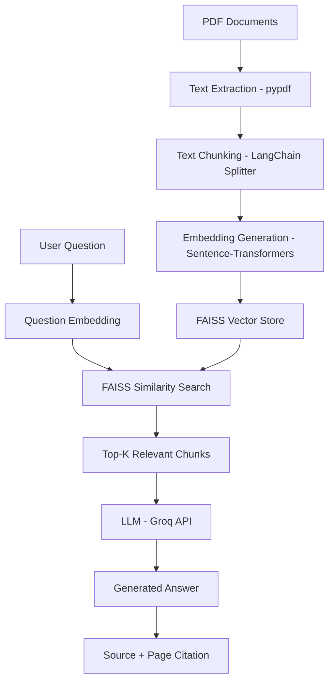
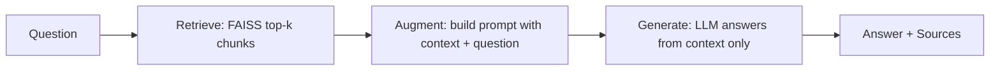
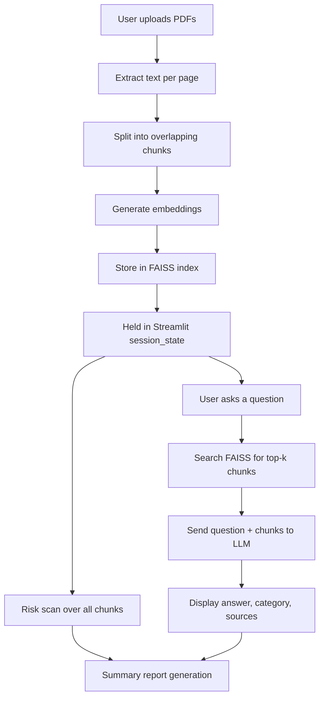
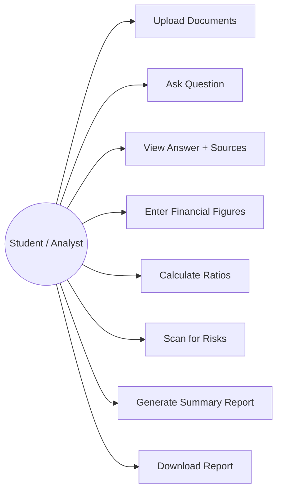
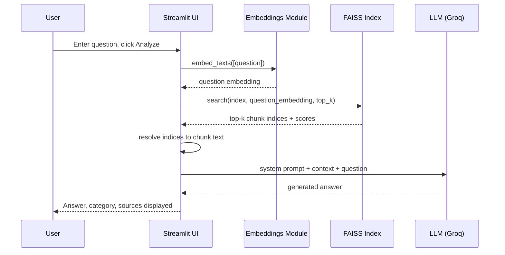

# Diagrams

These use Mermaid syntax — viewable directly on GitHub, in VS Code
(with a Mermaid extension), or at https://mermaid.live by pasting the
code block contents.

## 1. Overall System Architecture

## 2. RAG Pipeline

## 3. Data Flow

## 4. Use Case Diagram

## 5. Sequence Diagram — Asking a Question

